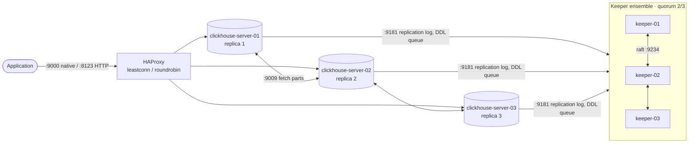

# clickhouse-1s3r-airgap

Bash scripts that install a **ClickHouse 25.12 cluster: 1 shard × 3 replicas + 3 dedicated
ClickHouse Keeper nodes** on Oracle Linux 9, **air-gapped**, driven from one admin host over SSH.
A second script sizes memory and caches from each node's real RAM.



Full diagram (topology + DC↔DR sync design): [`clickhouse-model.drawio`](clickhouse-model.drawio).

| Node | Lab IP | Role |
|---|---|---|
| clickhouse-server-01..03 | 192.168.62.11-13 | `clickhouse-server`, replica 1..3 of shard 1 |
| clickhouse-keeper-01..03 | 192.168.62.21-23 | `clickhouse-keeper`, server_id 1..3 |

## Ports

| Port | Service | Between |
|---|---|---|
| 9000 | Native TCP | Clients/HAProxy → servers, Distributed queries server ↔ server |
| 8123 | HTTP (`/ping` for health checks) | Clients/HAProxy → servers |
| 9009 | Interserver HTTP | Replicas fetch parts from each other |
| 9181 | Keeper client | Servers → keepers |
| 9234 | Keeper Raft | Keeper ↔ keeper |

## Layout

```
setup_1s3r_airgap_app.sh   # full install: hosts, RPMs, keeper, server, cluster config, verify
tune_ram_cache_app.sh      # memory.xml + profile_memory.xml from each node's MemTotal
inventory.txt              # the only file to edit: paths, app user, node list
rpm/                       # clickhouse-{server,client,common-static}-25.12.1.649 (not in git)
ddl_events.sql             # example ReplicatedReplacingMergeTree + Distributed table
config/                    # HAProxy config, static cache / memory-limit snippets
docs/ops-cheatsheet.md     # replica / keeper recovery commands
```

## How to run

From an admin host with root SSH (key based) to all 6 nodes:

```bash
cp /path/to/clickhouse-*.rpm rpm/
vi inventory.txt                       # IPs, hostnames, APP_BASE, CH_USER / CH_PASSWORD
./setup_1s3r_airgap_app.sh             # or: ./setup_1s3r_airgap_app.sh other-inventory.txt
./tune_ram_cache_app.sh                # reload only; add --restart for a rolling restart
clickhouse-client -h 192.168.62.11 --multiquery < ddl_events.sql   # needs a {site} macro, see the file
```

What `setup_1s3r_airgap_app.sh` does, in order:

1. Parse and validate `inventory.txt` (IP / hostname format, no duplicates, **odd keeper count**).
   The password is turned into a sha256 locally and `unset`. Only `password_sha256_hex` reaches the nodes.
2. Set hostnames and rewrite the cluster block in `/etc/hosts` on every node (idempotent).
3. Stop firewalld, scp the RPMs, `rpm -Uvh`.
4. Keepers: `keeper.xml` with the Raft member list, systemd drop-in pointing at `/APP/clickhouse`.
5. Servers: copy `config.xml` into `/APP/clickhouse/clickhouse-server`, write `config.d/`
   (`cluster.xml`, `keeper.xml`, `path.xml`, `listen.xml`, `macros.xml` with `replica=1..3`),
   `users.xml` + `users.d/<CH_USER>.xml`, systemd drop-in, restart.
6. Verify: listeners, DNS from every server, `system.clusters`.

## How to verify

```sql
SELECT cluster, shard_num, replica_num, host_name FROM system.clusters WHERE cluster = 'cluster_1S_3R';
SELECT * FROM system.zookeeper WHERE path = '/';          -- servers can reach Keeper
SELECT table, is_readonly, active_replicas, total_replicas FROM system.replicas;
```

```bash
echo ruok | nc 192.168.62.21 9181          # imok
echo mntr | nc 192.168.62.21 9181 | grep zk_server_state   # one leader, two followers
curl -s http://192.168.62.11:8123/ping     # Ok.
```

## Design decisions

| Decision | Why |
|---|---|
| 1 shard × 3 replicas | The data fits one node. Replicas give read scale and survive 2 node losses for reads. Sharding can come later via the Distributed table. |
| Dedicated Keeper nodes (not embedded in servers) | A server under heavy merge/query load cannot starve Keeper. Restarting a server never touches quorum. |
| 3 keepers, script rejects even counts | Raft needs a majority. 4 tolerates the same 1 failure as 3, and adds a vote that can split. |
| Hostnames in `remote_servers` / Raft config, `/etc/hosts` managed by the script | Replicas announce themselves by hostname. Without DNS, an unresolved name shows up as `DNS_ERROR` during part fetches. |
| Everything under `APP_BASE=/APP/clickhouse` via systemd drop-ins | Data, logs, config on the dedicated mount. RPM upgrades do not overwrite the copied `config.xml`. |
| Only `password_sha256_hex` on the nodes | The plaintext password never leaves the admin host. |
| Memory from real RAM: server 80%, per query 25%, per user 50%, spill at 12% | Same script fits 32 GB and 128 GB nodes. The remaining 20% is page cache, which ClickHouse reads lean on. |
| `SYSTEM RELOAD CONFIG` by default, `--restart` is rolling with a `SELECT 1` gate | Memory limits apply without downtime. A restart never takes more than one replica out. |
| `ReplicatedReplacingMergeTree`, daily partitions, `ttl_only_drop_parts` | Duplicate inserts / sync re-runs collapse on `(event_time, id)`. TTL drops whole parts instead of rewriting them. |
| HAProxy `leastconn` for native, `roundrobin` + `GET /ping` for HTTP | Native connections are long-lived and uneven. HTTP requests are short. |

## Troubleshooting

| Symptom | Likely cause | Check / fix |
|---|---|---|
| Tables `is_readonly = 1` | Server lost its Keeper session or Keeper lost quorum | `echo mntr \| nc <keeper> 9181`, then `SYSTEM RESTART REPLICA` ([cheat sheet](docs/ops-cheatsheet.md)) |
| `DNS_ERROR` / replica cannot fetch parts | Hostname of another replica not resolvable, or 9009 blocked | `getent hosts clickhouse-server-02`, `nc -zv <host> 9009` |
| `ON CLUSTER` DDL hangs | One server down or its DDL worker stuck; query waits for all hosts | `SELECT * FROM system.distributed_ddl_queue WHERE status != 'Finished'` |
| `No macro site` when running `ddl_events.sql` | `{site}` macro not defined (setup only writes `shard` / `replica`) | Add `<site>DC</site>` to `config.d/macros.xml` on every server |
| `MEMORY_LIMIT_EXCEEDED` | Query above `max_memory_usage` (25% of RAM) | Check `system.query_log`; spill thresholds are already set at 12% |
| Keeper will not start after a crash | Corrupt Raft log on that node | Rebuild that one node from the other two ([cheat sheet](docs/ops-cheatsheet.md)) |

## Next steps

- The `default` user has **no password and `::/0` access** in the generated `users.xml`
  (it was like that in the environment I built this for). Lock it to `127.0.0.1` or give it a password.
- Turn firewalld back on with only the ports above open, per source.
- HAProxy config is provided, not installed by the script. Add it (plus Keepalived for a VIP).
- DC ↔ DR sync job (`ch_sync.sh` in the diagram) is a design. The script is not in this repo yet.
- Backups: `clickhouse-backup` or `BACKUP ... TO S3`, with a restore test.

## License

[MIT](LICENSE)
